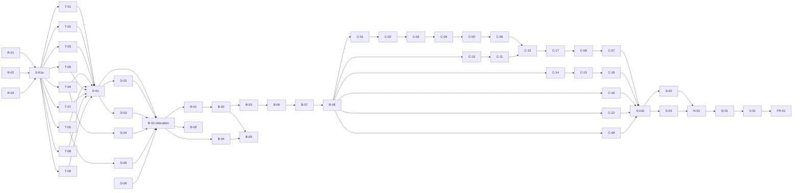

# Refactoring plan — credimi-capture-wallet

Status: approved audit (`AUDIT.md`) revised per `INSTRUCTIONS.md`. This file is the authoritative
task list. `PROGRESS.md` tracks execution, `DECISIONS.md` records architecture decisions, and
`FINDINGS.md` records out-of-scope discoveries. `AGENTS.md` overrides everything here.

Line numbers below refer to the baseline revision `ae9e74c` and drift as tasks land; always
re-locate symbols with `graft grep` / `graft skeleton` before editing.

## 1. Roles, models and isolation

| Role | Agent type | Model (resolved from local config) |
|---|---|---|
| Main agent, architect, orchestrator, integrator | main session | `anthropic/claude-opus-5-5` (high) |
| Implementation and test-writing subagents | `task` | `openai-codex/gpt-5.6-luna` (high), via `task.agentModelOverrides` |
| Independent reviewers, final architecture reviewer | `reviewer` | `anthropic/claude-opus-5-5` (high), via `task.agentModelOverrides` |

Both overrides were verified with probe subagents before execution (see `DECISIONS.md` ADR-01).
The session-only setting is `task.agentModelOverrides = {"task": "openai-codex/gpt-5.6-luna:high",
"reviewer": "anthropic/claude-opus-5-5:high"}`; re-apply it when resuming in a new session.

Workspace layout (outside the user's checkout, which keeps its uncommitted changes untouched):

| Path | Purpose |
|---|---|
| `/home/matteo/src/credimi-capture-wallet` | User checkout on `master`. Never written by the refactoring. |
| `/home/matteo/src/ccw-refactor/integration` | Integration worktree, branch `refactor/codebase-health` (base `ae9e74c`). |
| `/home/matteo/src/ccw-refactor/wt/<TASK>` | One isolated worktree per implementation task, branch `rf/<TASK>`. |
| `/home/matteo/src/ccw-refactor/scripts/` | `new-task-worktree.sh`, `test-inventory.sh`, `compare-inventory.sh`. |
| `/home/matteo/src/ccw-refactor/baseline/` | Baseline measurements of `ae9e74c`. |
| `/home/matteo/src/ccw-refactor/reports/` | Per-task inventories and review reports. |

Task lifecycle:

1. Main agent runs `scripts/new-task-worktree.sh <TASK>` (branch from integration tip) and captures
   the pre-task test inventory.
2. A Luna `task` subagent implements the assignment in that worktree only (absolute paths), runs the
   validation, and creates exactly one commit in the AGENTS.md format.
3. An Opus `reviewer` subagent reviews base..commit independently (read-only) and classifies
   findings Blocking / Major / Minor / Optional.
4. Blocking/major findings go back to the implementer, who amends the task commit; re-review.
5. Main agent cherry-picks the commit onto `refactor/codebase-health`, runs integration validation,
   updates `PROGRESS.md`, removes the task worktree.

At most three implementation subagents run concurrently, and only on disjoint files. Tasks that touch
`src/server.ts` / `src/server/app.ts`, shared interfaces or middleware order run sequentially.

## 2. Baseline (revalidated on `ae9e74c`, 2026-11-24)

| Measure | Value |
|---|---|
| Tests | 471 passed, 19 files (`baseline/inventory-ae9e74c.txt`) |
| Build (`pnpm build`) | pass |
| Lint (`pnpm lint`) | **fails**: Biome scans gitignored `graft/.graph/wiring.json` (> 1 MiB); `biome check src tests` clean |
| `tsc --noUnusedLocals --noUnusedParameters` | 8 diagnostics (5 src, 3 tests) |
| Coverage (v8, measured on a throwaway copy) | 87.05 % statements, 81.78 % branches |
| jscpd 5.4.3 health | 61 C (duplication 78, dead code 74, complexity 38; 33 947 code lines) |
| Duplication | 3.2 % lines, 97 clone pairs (≈ 70 in tests) |
| Knip 6.48.0 (production) | unused file `src/openid4vp-validation.ts`; unused dependency `dcql`; 17 unused exports groups |
| Madge 8.0.0 | 2 cycles: `attestbook/types.ts > metadata.ts`; `metadata.ts > config.ts > configurations/registry.ts > configurations/attestbook-experimental/index.ts > configurations/types.ts` |
| Largest modules | `tests/server.test.ts` 7922, `src/server.ts` 2590, `src/openapi.ts` 2257, `src/ui.ts` 1866, `src/credo-openid4vp.ts` 1473, `src/credo-openid4vci.ts` 1116, `src/config.ts` 1003 |
| Hotspots | `POST /openid4vp/sessions` cx 91; `POST /sessions` cx 65; `CredoOpenId4VpVerifier.createSession` cx 50 / 231 lines; `mapCredentialRequest` 150 lines; `createApp` 1652 lines |

Uncovered protocol surfaces at baseline: `POST /openid4vp/response` (documented alternative
direct-post endpoint, `CAPTURE_WALLET_API.md:685`); mdoc presentation path; credential-request
encryption rejection paths (`credential-encryption.ts` 55 % branches); `credential-registry.ts`
conflict/rollback; Attestbook settings, bounded fetch and webhook rejections; `cli.ts` 0 %.

## 3. Target architecture

### 3.1 Directory structure

```
src/
├── cli.ts                      # package.json "bin" entry (path is part of the CLI contract)
├── cli/commands.ts             # B-09: side-effect-free command implementations
├── state.ts                    # CaptureStore: issuance + VP session state, events (cross-domain)
├── types.ts                    # shared domain and evidence types (X-5 re-evaluated in Phase 7)
├── shared/
│   ├── errors.ts               # B-01: errorMessage
│   └── json.ts                 # B-02: isRecord, asRecord (null-returning), isStringArray, asStringOrNull
├── config/                     # B-06/B-07: split of src/config.ts
│   ├── defaults.ts             # constants, DEFAULT_CONFIG, normalizeBaseUrl, InitOptions
│   ├── paths.ts                # *Path helpers and *_FILE constants
│   ├── verifier-identity.ts    # verifier key ids, DID, attestation-issuer identity
│   ├── environment.ts          # env/URL parsing, resolve* helpers, .env loading
│   ├── config-file.ts          # config.yaml parse/stringify (hand-written format, unchanged)
│   ├── load.ts                 # loadConfig (env/file precedence)
│   └── key-material.ts         # initIssuer, validateIssuerMaterial, signing contexts, certificates
├── configurations/             # issuer configuration registry (unchanged layout)
├── credentials/                # credential types, independent of the protocol
│   ├── definitions.ts          # ← credential-definitions.ts
│   ├── catalogue.ts            # B-08: supported-credential catalogue (from metadata.ts)
│   ├── signing.ts              # ← credential.ts (Credo sign options per credential type)
│   ├── registry.ts             # ← credential-registry.ts
│   └── digest-algorithm.ts     # ← digest-algorithm.ts
├── status-list/                # Token Status List
│   ├── allocation.ts           # ← status-list.ts
│   ├── reference-fixtures.ts   # ← status-reference.ts
│   └── malformed-mdoc-status.ts# ← malformed-mdoc-status.ts
├── credo/                      # Credo-TS agent runtime shared by issuer and verifier
│   ├── agent.ts                # B-04: in-memory storage, NodeKmsBackend, agent dependencies
│   └── kms-encryption.ts       # ← kms-encryption.ts
├── openid4vci/                 # issuer protocol
│   ├── credo-issuer.ts         # ← credo-openid4vci.ts
│   ├── attribution.ts          # C-10
│   ├── evidence.ts             # C-10
│   ├── credential-mapping.ts   # C-11
│   ├── metadata.ts             # ← metadata.ts (after B-08 moves the catalogue out)
│   ├── proofs.ts               # ← proofs.ts
│   ├── client-attestation.ts   # ← client-attestation.ts
│   ├── key-attestation.ts      # ← eudi-key-attestation.ts
│   ├── credential-encryption.ts# ← credential-encryption.ts
│   ├── notification.ts         # ← oid4vci-notification.ts
│   ├── http-capture.ts         # ← oid4vci-capture.ts
│   └── fake-oauth-server.ts    # ← fake-oauth-server.ts
├── openid4vp/                  # verifier protocol
│   ├── credo-verifier.ts       # ← credo-openid4vp.ts
│   ├── request-construction.ts # C-09
│   ├── presentation-decoding.ts# B-05
│   ├── authorization-request.ts# ← openid4vp.ts (response modes, client ids, request signing, DCQL defaults)
│   ├── request-certificates.ts # ← request-certificates.ts
│   ├── request-object-encryption.ts
│   └── verifier-attestation.ts
├── fcaf/                       # conformance-testing scenario machinery (FCAF_SCENARIOS_ENABLED)
│   ├── json-pointer.ts
│   ├── request-mutation.ts
│   ├── request-behavior.ts
│   └── response-scenario.ts
├── federation/                 # unchanged
├── attestbook/                 # unchanged layout
├── server/
│   ├── app.ts                  # ← server.ts; becomes the composition root in C-07
│   ├── context.ts              # C-07: ServerContext (per-request OpenID4VCI capture seam)
│   ├── issuance-session-input.ts      # C-02
│   ├── presentation-session-input.ts  # C-03
│   ├── vp-request-uri.ts              # C-04
│   ├── credential-endpoint.ts         # C-05
│   ├── vp-submission.ts               # C-01
│   └── routes/                 # C-07 router factories, all mounted at "/"
├── openapi/                    # C-08 split of openapi.ts
├── ui/                         # C-17 split of ui.ts
└── design/                     # served static assets (paths are cwd-relative strings; unchanged)

tests/
├── support/                    # S-01: environment, keys/DPoP, http, issuance, presentation, mdoc helpers
└── <domain>.test.ts            # S-02 splits server.test.ts by concern
```

Rationale and rejected alternatives: `DECISIONS.md` ADR-02.

### 3.2 Architectural principles (binding for every task)

- Deep modules with small interfaces; no generic service layers, no compatibility re-export layers,
  no barrels. Callers are updated directly.
- Extract only cohesive responsibilities; do not move complexity into helpers just to shrink a
  function. Prefer options objects over long positional lists of same-typed parameters.
- Deduplicate only semantically equivalent code (inputs, returns, errors, side effects, ordering,
  defaults, security checks, evidence, null vs undefined).
- Preserve: HTTP endpoints, schemas, status codes, error codes/descriptions, content types, headers,
  redirects, config formats, env semantics, CLI, persistence formats, session lifecycle, event order,
  evidence capture, redaction, OpenAPI output, UI output; validation order where it selects the
  error; side-effect order where it affects protocol, session state or evidence.
- Credo-TS stays the protocol/crypto library. No new protocol/crypto libraries, no runtime
  dependencies, no Credo version change. Intentional malformed/negative FCAF behaviour is preserved.
- Comments explaining protocol, security, interoperability, intentional malformation or ordering are
  kept; comments that restate code are removed only in code the task already touches.
- Characterisation tests come before production changes. Discovered bugs go to `FINDINGS.md`, not
  into silent fixes.

### 3.3 Validation strategy

Per task (in its worktree):

```
pnpm format            # repository formatter (biome format --write .)
pnpm test
pnpm build
task lint              # pnpm lint + lint:design
pnpm exec tsc -p tsconfig.json --noEmit --noUnusedLocals --noUnusedParameters   # no new diagnostics
```

plus the task's own checks: focused Vitest files, `task analyze:*` measurements, output-equality
scripts for deterministic output, HTTP contract tests, and the test-inventory comparison against the
immediate pre-task inventory (`scripts/test-inventory.sh` + `scripts/compare-inventory.sh`). Every
added, removed, renamed or relocated test must be justified in the commit and in `PROGRESS.md`.

Output comparison: byte-identical only for deterministic output (OpenAPI JSON, HTML pages with fixed
inputs, config files). For JWTs, certificates, nonces, timestamps: control inputs where practical,
compare decoded structures semantically and verify signatures independently.

Integration (after each batch, in `integration/`): cherry-pick reviewed commits, inspect combined
diff, run the full validation, run `task analyze` when structure changed, refresh Graft
(`graft build`), update `PROGRESS.md`.

Interoperability (Phase 8): see §6.

## 4. Revised task list

Severity / risk / benefit and the concrete findings come from `AUDIT.md`; revisions are marked
**Revised**. Each task lists Files/symbols, Problem, Refactoring, Benefit, Dependencies, Risks,
Validation, Acceptance.

### Phase 0 — Tooling, planning and baseline

#### R-01 · Make the lint gate green
- Files: `biome.json` (`files.ignore`).
- Problem: `pnpm lint` fails on Graft's generated `graft/.graph/wiring.json`; AGENTS.md requires
  `task lint` before every commit.
- Refactoring: replace the `graft/.cache` ignore entry with `graft` (the directory is gitignored and
  entirely generated). Do not raise `files.maxSize`, do not ignore any source/test path.
- Dependencies: none. Risks: none.
- Validation: `pnpm lint`, `task lint`; compare Biome's checked-file count before/after excluding
  `graft/` (must still include every `src/` and `tests/` file).
- Acceptance: both exit 0; no source or test file dropped from lint.

#### R-02 · Correct stale facts in AGENTS.md
- Files: `AGENTS.md` repo map and "Design Source".
- Problem: lists non-existent `src/client-auth.ts`, `src/pkce.ts`; names `src/design/atlas-style.css`
  (actual `src/design/style.css`); omits `credo-openid4vci.ts`, `attestbook/`, `configurations/`,
  `federation/`, `request-*.ts`, `fcaf`-style modules.
- Refactoring: fix those facts only (PKCE: `fake-oauth-server.ts` + Credo-TS; client-attestation
  evidence: `client-attestation.ts`). Full rewrite for the new layout is N-01.
- Acceptance: every path mentioned in AGENTS.md exists.

#### R-03 · Integrate static-analysis tooling (Decision 2) — **new**
- Files: `mise.toml`, `package.json`, `pnpm-lock.yaml`, `Taskfile.yml`, `knip.json`, `.jscpd.json`,
  `.gitignore` (coverage output already ignored), `vitest.config.ts` only if needed for coverage
  configuration.
- Refactoring:
  - `@vitest/coverage-v8@2.1.9` as an exact-pinned devDependency (matches installed Vitest 2.1.9; no
    Vitest upgrade).
  - Knip 6.48.0, JSCPD 5.4.3, Madge 8.0.0 declared in `mise.toml` as pinned `npm:` tools (ADR-03);
    no new runtime dependencies.
  - `knip.json`: entry `src/cli.ts`, project `src/**/*.ts`, `tests/**/*.ts`; ignore `.claude/**`.
  - `.jscpd.json`: format typescript, paths `src`, `tests`, output to `coverage/jscpd` (gitignored)
    or console-only reporters.
  - Taskfile: `analyze:dead-code` (knip, plus knip `--production`), `analyze:duplication` (jscpd),
    `analyze:cycles` (madge `--circular --extensions ts src`), `test:coverage` (vitest run with v8
    coverage, text + json-summary), `analyze` (all four). Measurement only: no thresholds yet.
- Validation: each task runs and produces the baseline numbers in §2; `pnpm test`, `pnpm build`,
  `task lint`.
- Acceptance: `task analyze` reproduces the baseline measurements; no runtime dependency added.

### Phase 1 — Minimal shared test infrastructure

#### S-01a · Foundational test support — **new split of S-01**
- Files: new `tests/support/environment.ts`, `tests/support/http.ts`, `tests/support/keys.ts`,
  `tests/support/issuance.ts`, `tests/support/presentation.ts`, `tests/support/support.test.ts`.
  `tests/server.test.ts` and other suites are **not** modified in this task.
- Problem: protocol helpers in `tests/server.test.ts:7504-7922` close over module-level `config`,
  `dataDir`, `conformingIssuerPath`, so new suites cannot reuse them.
- Refactoring (copy-and-parameterise, explicit dependencies, no fixtures framework):
  - `environment.ts`: `createIssuerTestEnvironment({ prefix, config? })` → `{ dataDir, config,
    cleanup() }` (mkdtemp + `DEFAULT_CONFIG` + `issuer_base_url: "http://issuer.example.test"` +
    `initIssuer({ force: true })`); `CONFORMING_ISSUER_ID`, `issuerPath(id)`, `requireIssuer(config,
    id)` (throws when missing); `createTestApp(config)`.
  - `http.ts`: `getJson`, `postJson`, `postForm` (typed supertest wrappers, assert 2xx with response
    text as message — same as current helpers).
  - `keys.ts`: `generateEs256Key()` (extractable ES256, `{ publicJwk, privateKey }`),
    `dpopProof(key, { method, url, accessToken? })` producing the same claims as
    `server.test.ts:7591-7606` (`typ: dpop+jwt`, `jti`, `iat`, `htm`, `htu`, `ath` when token).
  - `issuance.ts`: `createIssuanceSession(app, body)`, `redeemPreAuthorizedCode(app, { issuerPath,
    session, dpopKey, baseUrl })`, `credentialProofJwt(key, nonce, audience, …)` as in
    `server.test.ts:7510-7630`.
  - `presentation.ts`: `createVpSession(app, body)`, `fetchRequestObject(app, session)`,
    `dcqlForClaims(claims)`, `sdJwtCredential(config)`, `sdJwtPresentation(...)`,
    `encryptedAuthorizationResponse(...)` as in `server.test.ts:7555-7798`.
  - `support.test.ts`: characterisation that the helpers drive real flows: pre-authorized issuance
    with DPoP yields a credential; an SD-JWT presentation is `presentation_validated`.
- Keep file-local in their suites (not moved here): notification JWT-only defaults, Attestbook
  `requestCredential`, scenario-specific builders.
- Validation: standard + inventory (only additions).
- Acceptance: helpers have no module-level mutable state; each new test file can create its own
  environment; existing suites untouched.

### Phase 2 — Regression protection (tests only; no `src/` changes)

All new suites use `tests/support/*`, live in new files, and assert exact status codes, protocol error
codes/descriptions, response structures, evidence fields and ordering as the code produces them
**today**. Any surprising behaviour is recorded in `FINDINGS.md`, not fixed.

#### T-01 · VP response endpoints
- Targets: `POST /openid4vp/response` (`server.ts:1582-1622`) — alternative direct-post endpoint that
  selects the session by `state` (not the session's `response_uri`; audit correction): success,
  missing/unknown `state`, invalid presentation, FCAF response-scenario gating
  (`CAPTURE_WALLET_API.md:587`). `GET /openid4vp/sessions/:id/events` (1625).
  `/openid4vp/redirect` with unknown code (1316, HTML 404).
- Acceptance: ranges covered; assertions include evidence in `session.raw` and events.
- File: `tests/openid4vp-response-endpoints.test.ts`.

#### T-02 · Error matrices for session creation, request URI and credential endpoint
- `POST /sessions`: every 400 code, 409 `CredentialSupersededError` (`server.ts:968-975`, throw site
  2039-2042), validation order (e.g. `status_reference` before `fixture`).
- `POST /openid4vp/sessions`: uncovered 1100-1101, 1108-1109, 1123-1128, 1149-1150, 1175-1176,
  1187-1188, 1232-1233; `ClientMetadataError`/`ResponseModeError` mapping (1299-1303); duplicated
  `request_behavior_not_enabled` (1143).
- `POST /openid4vp/sessions/:id/request`: unsupported `wallet_metadata` encryption (1480-1491),
  re-sign path (1395-1436, 1425).
- `POST /issuers/:id/credential`: plain JSON, encrypted JWE body, response encryption without JWE
  (400 `invalid_encryption_parameters`), superseded definition (400); 1640-1643, 1721, 1735-1736.
- `verifierAttestationOrNull` malformed `claims`/`redirect_uris` (2556-2557).
- Approach: table-driven rows `(input, status, body)`.
- Files: `tests/issuance-session-errors.test.ts`, `tests/presentation-session-errors.test.ts`,
  `tests/credential-endpoint.test.ts`.

#### T-03 · Credential-encryption security checks
- File: `tests/credential-encryption.test.ts`, direct calls to exported functions.
- Cases: missing issuer key (33-34); undecryptable (46-47); `alg`/`enc` mismatch (49-53); `kid`
  mismatch (55-58); non-`CredentialEncryptionError` wrapped (61-63); missing `jwk`, private material,
  bad `jwk.alg`/`enc`, `zip` (74-93); invalid public JWK, unsupported kty/curve (99-112);
  encrypt/context errors (139-151); issuer key without `kid` (167-168); unexpected serialisation
  (227-228, 241-242); invalid JSON payload (304-305); `kid` filled from `legacyKeyId`.
- Acceptance: `CredentialEncryptionError` + exact message per rejection; ≥ 90 % branch coverage of the
  file. Do not replace `CredentialEncryptionKms` with `NodeKmsBackend`.

#### T-04 · Credential-registry conflicts and rollback
- File: `tests/credential-registry.test.ts`, `new CredentialRegistry(config)` with a stub synchroniser.
- Cases: duplicate configuration id; conflict with a static credential by id, scope, vct;
  non-importing issuer; sync failure with previous catalogue (restored, original error rethrown); no
  previous (imports cleared); sync + restore failure (combined message); a failed operation does not
  poison the queue.
- Acceptance: uncovered 99-144 covered.

#### T-05 · mdoc presentation end to end
- File: `tests/mdoc-presentation.test.ts` (+ helpers in `tests/support/mdoc.ts`).
- Accepted: DeviceResponse built with the OpenID4VP Appendix B session transcript
  (`mdocSessionTranscript`, currently `src/openid4vp-validation.ts:428-460`, imported from `src/` for
  now; D-05 moves it) → `status: "presentation_validated"`, all `checks` true,
  `decoded_presentations.query_0[0]` with `format`, `document_types`, `issuer_claims`,
  `device_claims`. Rejected: wrong nonce or origin; a second document when `multiple` is not true.
- Also `tests/json-pointer.test.ts`: overwrite an existing array index; `"/keys/x"` throws
  "not an index" (`json-pointer.ts:109-114`).
- Acceptance: `credo-openid4vp.ts:1006-1014` covered. If Credo cannot verify a locally built mdoc
  without trust changes, escalate (do not weaken trust).

#### T-06 · Attestbook security checks
- Files: `tests/attestbook-settings.test.ts`, `tests/attestbook-http.test.ts`,
  `tests/attestbook-webhook.test.ts`, `tests/attestbook-reconcile.test.ts`, json-schema cases in a new
  or existing focused file.
- Targets: `resolveAttestbookSettings`, `trustedOrigin`, `isLoopbackHost` (`settings.ts:28-86`);
  `boundedGet` every `AttestbookFetchErrorCode` via injected `fetch` stubs (no network); webhook
  rejection branches (`integration.ts:252-350`: non-JSON, non-object, missing headers, invalid event,
  unsupported type, unconfigured secret, event-id/rulebook mismatch, persistence failure 503);
  reconcile stages (`activation_rolled_back`, `persist_failed`, rejected-digest skip on non-manual
  trigger, retry cap 8); unsupported JSON-Schema keyword diagnostics and their order.
- Acceptance: exact codes, statuses, messages and diagnostic order asserted; no secret leakage.

#### T-07 · Issuer-configuration validation errors
- File: `tests/configurations-validation.test.ts`; table of every `throw` in
  `configurations/validate.ts` (22-55). No refactor follows.

#### T-08 · CLI behaviour
- File: `tests/cli.test.ts`; subprocess `tsx src/cli.ts` (tsx is a devDependency) in temp dirs.
- Cases: `init` summary keys; `federation-jwks` and `federation-registration` shapes,
  `--issuer-configuration-id` filtering, "Unknown or disabled" error, refusal when federation is
  disabled; unknown command → exit code 1; attestbook argument validation / missing token.
- Also run once through the pnpm bin (`pnpm exec capture-services --help`-equivalent) to pin symlink
  behaviour.

#### T-09 · Conditional OpenAPI paths
- File: `tests/openapi.test.ts`; federation, Attestbook and notification paths/tags present only when
  enabled (`openapi.ts` 76-91, 144-170, 283-347, 1048-1108); all four flag combinations.

### Phase 3 — Dead code removal

#### D-01 · Unused imports, locals and parameters
- `server.ts:53` `supportedCredentials`, `:114` `VerifierResponseHttpCapture`; `credential.ts:1`
  `MdocSignOptions` and the unread certificate at `credential.ts:69-70`; `verifierAttestationClientId`
  `attestation` parameter (`verifier-attestation.ts:81`) and its caller (`credo-openid4vp.ts:342`);
  `tests/server.test.ts:64` `PID_SD_JWT_CLAIMS`, `:67` `CREDIMI_LOGO_URL`, `:7504` `postForm`.
- Acceptance: strict tsc clean except `openid4vp-validation.ts` (D-05).

#### D-02 · Legacy pre-Credo request builder in `openid4vp.ts`
- Delete `REQUEST_OBJECT_AUDIENCE` (30), `createJarmEncryptionJwk` (138-152),
  `buildPresentationAuthorizationRequest` (154-170), `presentationRequestByReferenceDeeplink`
  (223-235), `vpResponseUri` (274-276), `verifierClientMetadata` (308-324) and now-unused imports.
- Compute `x509_hash` in `verifierClientIdentifiers` with `x509HashClientId`
  (`request-certificates.ts:97-103`), delete `verifierClientId`/`verifierCertificateSha256` after
  confirming byte-identical output. Use `vpRequestUri` at `credo-openid4vp.ts:323-325`.
- Risks: client identifiers (`server.test.ts:968-994`, 1159, 1189).

#### D-03 · Dead wrappers, re-exports, unreachable defaults
- `metadata.ts` `signedCredentialIssuerMetadata` (110-121), `PID_MDOC_NAMESPACE`/`PID_SD_JWT_VCT`
  re-exports (56); `credential.ts` `CREDIMI_WEBSITE` re-export (33); `state.ts`
  `defaultIssuerConfiguration`/`defaultCredentialConfigurationId` (395-410) → parameters required;
  `federation/registration.ts` `issuerFederationJwks` alias and unused `enabled` parameter (returned
  object keeps `enabled: true`).
- Keep `issueSdJwtCredential`, `CREDIMI_LOGO_URL` (test fixtures).
- Acceptance: T-08 CLI output unchanged.

#### D-04 · Stop exporting internal-only symbols
- Remove `export` only (Knip candidates verified by hand): `config.ts` `*_ENV_VAR`/`*_FILE` constants
  and internal helpers; `attestbook/settings.ts`, `webhook.ts`, `json-schema.ts` constants;
  `configurations/registry.ts:27`, `pid-fixtures.ts:12`; `credential-encryption.ts:17-18`;
  `credential-registry.ts:24-29,150-163`; `metadata.ts:176-182,227-233`; `json-pointer.ts:12`
  `parseJsonPointer`; `openid4vp.ts` `DC_API_PRESENTATION_TTL_SECONDS`, `VpRequestSigner`; `ui.ts`
  `PresentationParameterValues`, `VerifierCredentialGroup`; `tests/attestbook-fixture.ts` `sri`;
  unexported-type candidates in `configurations/types.ts`, `attestbook/types.ts`, `pid-data.ts`,
  `attestbook/integration.ts`.
- Keep everything tests import. Acceptance: Knip unused-export list contains only test-consumed
  symbols or documented exceptions.

#### D-05 · Remove `openid4vp-validation.ts` (Decision 1 approved)
- Preconditions: T-05 landed; no production/dynamic/external consumer (grep src, tests, docs,
  package.json, scripts); Credo-TS handles verification (`credo-openid4vp.ts:498-596`).
- Move `mdocSessionTranscript`, `oid4vpJwkThumbprint` and a digest-only mdoc context to
  `tests/support/mdoc-session-transcript.ts`; rename `tests/openid4vp-validation.test.ts` →
  `tests/mdoc-session-transcript.test.ts` (same tests); repoint T-05.
- Delete the source file; remove the `dcql` direct dependency (package.json + lockfile) if unused;
  update AGENTS.md map and any docs.

#### D-06 · Remove obsolete test-only helpers (Decision 3 approved)
- Delete `jwkToJwks`, `firstWalletJwks` (`proofs.ts:135-157`) and tests that exclusively exercise
  them (`tests/proofs.test.ts:29-48` region); keep assertions on live functions. Do not merge with
  the inline logic in `mapCredentialRequest` (`in` vs `!== undefined` differ).
- Record removed functions/tests, reasons and evidence in `PROGRESS.md`.

### Phase 4 — Architecture and module boundaries

#### B-10 · Relocate modules into domain directories — **new**
- Pure `git mv` + import rewrites per §3.1 mapping; no content change besides import specifiers.
  `src/cli.ts`, `state.ts`, `types.ts` stay; `config.ts`, `ui.ts`, `openapi.ts` stay until their split
  tasks; `server.ts` → `server/app.ts`.
- Must preserve: `src/design/...` cwd-relative strings in server code; `new URL("../../pid_portrait.jpg",
  import.meta.url)` in `configurations/shared/pid-data.ts` (unchanged location); package.json `bin`
  and scripts (`src/cli.ts`).
- Validation: `git diff -M --stat` shows renames only; standard validation; inventory identical.
- Acceptance: §3.1 layout in place for moved files; no other change.

#### B-01 · `errorMessage` in `src/shared/errors.ts`
- Sites: `server.ts:1951`, `credential-encryption.ts:315`, `credential-registry.ts:165`,
  `attestbook/integration.ts:762` (identical). Keep `credoErrorMessage` (fallback variant) local.

#### B-02 · Equivalent JSON guards in `src/shared/json.ts`
- `isRecord`: replace export from `attestbook/snapshot.ts:362` (7 importers) and copies in
  `credo-openid4vci.ts:1100`, `fake-oauth-server.ts:315`, `oid4vci-capture.ts:289`.
- Null-returning `asRecord`: `credential-encryption.ts:311`, `credo-openid4vp.ts:1421`, and
  `server.ts:2461` `objectOrNull` (same predicate, same `null`).
- `isStringArray` (`metadata.ts:165`; `proofs.ts:216` `asStringArray` only if equivalent).
- `asStringOrNull` moved from `state.ts:391` (non-empty string semantics; name kept).
- Do not merge undefined-returning `asRecord` (`proofs.ts:206`, `client-attestation.ts:84`) or
  `asString` variants (X-7).

#### B-03 · Break both import cycles
- Move `CredentialFormat`, `CredentialProofPolicy` (`metadata.ts:29-33`) to `src/types.ts`; move
  `AttestbookIssuerSummary` (`ui.ts:19-24`) to `attestbook/types.ts`. Update importers directly.
- Acceptance: `task analyze:cycles` reports 0; `attestbook/integration.ts` does not import `ui`.

#### B-04 · Credo agent runtime → `src/credo/agent.ts`
- Move `InMemoryStorageModule`/`InMemoryStorage`, `NodeKmsBackend`, `nodeAgentDependencies`
  (`credo-openid4vp.ts:1120-1473`) with private helpers, unchanged. Update `credo-issuer.ts` and
  `tests/credo-issuer-hot-update.test.ts`. Do not merge with `CredentialEncryptionKms` or the other
  `publicJwk` (random-`kid` difference).
- Acceptance: `openid4vci/` does not import `openid4vp/`.

#### B-05 · Presentation decoding → `src/openid4vp/presentation-decoding.ts`
- `DecodedPresentation(s)`, `decodedPresentationsFromDcql`, `decodedPresentationFromCredo`,
  `toJsonSafe`/`toJsonSafeValue`, `trustedIssuerForX509Credential` (`credo-openid4vp.ts:146-164,
  988-1118`). Update `tests/credo-openid4vp.test.ts`.
- Acceptance: decoded evidence unchanged (T-05 mdoc + SD-JWT tests).

#### B-06 · Config split phase A: `config/paths.ts`, `config/verifier-identity.ts`
- `*Path` helpers and `*_FILE` constants (`config.ts:25-27, 289-348, 395-397`); verifier key ids,
  attestation-issuer helpers, `verifierDid`/`verifierDidDocument` (22-24, 350-393). Importers updated
  directly.

#### B-07 · Config split phase B
- Tests first: `config.yaml` round-trip characterisation for `parseYamlConfig`/`stringifyYaml`
  (every key `init` writes; `""`, quoted strings, `"true"` vs `true` case-sensitivity, negative and
  decimal numbers, JSON arrays, inline `#`, CRLF, duplicate key last-wins).
- Split remaining `config.ts` into `config/defaults.ts`, `config/environment.ts` (114-254),
  `config/config-file.ts` (256-287), `config/load.ts` (399-454), `config/key-material.ts` (456-1003);
  delete `src/config.ts`. `attestbook/settings.ts:28-34` reuses the environment boolean parser only if
  accepted tokens and error text are identical. No YAML library; `config.yaml` mode `0o600`.
- Acceptance: `init` output files and contents identical (output-equality over a temp dir; key
  material compared structurally).

#### B-08 · Credential catalogue → `src/credentials/catalogue.ts`
- `SupportedCredential`, `StaticCatalogueIssuer`, configuration-id helpers, `supportedCredentials*`,
  claim-path helpers (`metadata.ts:29-56, 176-393`); metadata output stays in
  `openid4vci/metadata.ts`. Keep `supportedCredentials` a literal.
- Acceptance: metadata JSON byte-identical per issuer; `tests/metadata.test.ts` unchanged.

#### B-09 · CLI testability → `src/cli/commands.ts`
- `runCommand(command, args, io)` and `initSummary` without side effects; `parseArgs` moves from
  `config.ts:70-85`; `src/cli.ts` keeps calling `main()` (no `import.meta.url === argv[1]` guard:
  breaks under pnpm bin symlinks).
- Acceptance: T-08 unchanged; direct `runCommand` tests added.

### Phase 5 — Production code simplification

Server track runs strictly sequentially in this order: C-01 → C-02 → C-03 → C-04 → C-05 → C-06 →
C-13 → C-17 → C-08 → C-07.

#### C-01 · Deduplicate VP submission and session lookups → `src/server/vp-submission.ts`
- `server.ts:1502-1546` ≡ `1586-1624` → `submitPresentation(...)`; each route keeps its preamble
  (only the session-scoped route applies `dcApiSubmissionRejectionOrNull`). Lookup preambles
  1346≡1366, 984≡992 (API JSON), 492≡512 (UI HTML) and 619≡684 (issuer + unmatched marking). Keep the
  federation lookup (651-679) and HTML vs JSON variants separate.
- Depends: T-01, B-02.

#### C-02 · `POST /sessions` input → `src/server/issuance-session-input.ts`
- `parseIssuanceSessionInput` (→ `{ ok: true, value } | { ok: false, status, body }`),
  `resolveIssuanceTarget`, `parsePidOptions`, `serializeIssuanceSession`. Preserve check order, every
  error body (`supported_*`, `unsupported_parameters`), 409 mapping, `offer` null → 500.
- Depends: T-02, C-01. Acceptance: handler cx ≤ 15; T-02 unchanged.

#### C-03 · `POST /openid4vp/sessions` input → `src/server/presentation-session-input.ts`
- `parseVpSessionInput` (1097-1145), `deriveVpSessionOptions` (1146-1150),
  `validateVpSessionCombination` (1151-1243; `existsSync` and trust-anchor checks keep order),
  `parseVpRequestOverride`, `serializeVpSession`; keep the duplicated `request_behavior_not_enabled`
  check, `ClientMetadataError`/`ResponseModeError` mapping.
- Depends: T-02, C-02. Acceptance: handler cx ≤ 15; T-02 unchanged.

#### C-04 · `POST /openid4vp/sessions/:id/request` → `src/server/vp-request-uri.ts`
- `recordWalletNonceRequest`, `resignDeliveredRequest`, `sendNegotiatedRequestObject`; preserve the
  intentional `sendRequestUriResponse(…400…)` (1465-1471) and `vp_request_retrieved` payload.

#### C-05 · `POST /issuers/:id/credential` → `src/server/credential-endpoint.ts`
- `readCredentialRequestBody`, `recordCredentialRequestEvidence`, `pinnedDefinitionMismatch`,
  `forwardCredentialRequest`; encryption interceptor before scenario interceptor (comment 1714-1716),
  `Cache-Control: no-store`, redaction unchanged.

#### C-06 · `createVpSession` options and `verifierAttestationOrNull`
- `CreateVpSessionOptions` replaces 16 positional parameters (`server.ts:2116`), same defaults;
  `recordVpSessionState`; `redirectUrisOrStringOrNull` in `verifierAttestationOrNull` (2544).

#### C-13 · `CaptureStore.createSession(issuer, options)`
- Tests first: new `tests/state.test.ts` pinning `SessionCapture` keys and `session_created` detail.
- Replace 10 positional parameters (`state.ts:65`); update both callers (`credo-openid4vci.ts:674`,
  server `createIssuanceSession`). Depends: D-03, C-06, C-11.

#### C-17 · UI page families → `src/ui/`
- `html.ts` (`escapeHtml`, `htmlPage`), `launcher.ts`, `issuer.ts`, `verifier.ts`, `session.ts`,
  `markdown.ts`, `styles.ts` (`APP_CSS` verbatim), `scripts.ts` (four script strings verbatim);
  delete `src/ui.ts`, update importers directly. Tests first: `errorPage` (1062-1076) and Attestbook
  summary branches. Output-equality script renders every page function with fixed inputs →
  byte-identical HTML. Depends: B-03.

#### C-08 · OpenAPI → `src/openapi/`
- `common.ts`, `paths-service.ts`, `paths-issuance.ts`, `paths-presentation.ts`,
  `paths-openid4vci.ts`, `paths-federation.ts`, `components.ts`, `document.ts`; insertion order
  preserved. Output-equality: `JSON.stringify(openApiDocument(cfg))` byte-identical for the four flag
  combinations. Missing paths are **not** added (X-2). Depends: T-09.

#### C-07 · `createApp` composition root → `src/server/context.ts`, `src/server/routes/*`
- `ServerContext` owns the per-request capture `WeakMap` and its three functions (148-212). Router
  factories mounted at `/` (never a prefix; `req.path` drives capture attribution): public, ui,
  discovery, issuer-metadata, issuance-session, presentation-session, presentation-request,
  presentation-response, credential, protocol-forwarding.
- Preserve: webhook raw parser → body parsers → parse-error handler → capture middleware → fake OAuth
  → routes; `next()` fallthrough routes (`/issuers/:id` UI 321-352, 1778); unmatched 404 before 500.
- Tests first: HTTP-level routing/fallthrough/middleware tests (parse errors, unmatched capture,
  `/issuers/:id` fallthrough, raw webhook body). Validation: recursive route inventory (walks nested
  router stacks, method + path + order) for four configurations before/after — identical.
- Acceptance: `server/app.ts` is the composition root (< 300 lines). Depends: C-01…C-06, C-13, C-17,
  C-08.

#### C-09 · `CredoOpenId4VpVerifier.createSession` → `src/openid4vp/request-construction.ts`
- Tests first: structural snapshots of `CredoVpSession` for `by_reference`, `by_value`, `plain`,
  `multisigned`, `dc_api` and a `request_mutation` (delivered request differs from verifier copy).
- Extract `authorizationRequestForVerifier` (282-305), `applyClientMetadata` (301-319),
  `signedDeliveryPlan` (330-414), `requestEnvelope` (417-439). Keep the 13-parameter signature
  (options-object change only if the reviewer agrees it is safe; otherwise FINDINGS).
- Preserve mutation → signing → corruption order, attestation `client_id`, Section 5.3 state removal.
- Depends: T-05, B-04.

#### C-10 · Issuance attribution/evidence → `openid4vci/attribution.ts`, `openid4vci/evidence.ts`
- Move verbatim from `credo-openid4vci.ts:907-1116`: `issuanceSessionQuery`,
  `accessTokenSessionQuery`, `issuanceSessionAuthorizes`, `captureStatus`, `requestHeaders` →
  attribution; `captureAuthorizationEvidence`, `setObservedString`, `redactCredentialRequest` →
  evidence; `wwwAuthenticateChallenge` → `openid4vci/notification.ts`. Then table tests (endpoint
  types incl. RFC 9126 authorize prefix, duplicated headers, pre-authorized mismatch, unknown state).
- Acceptance: 963, 983, 1028-1029, 1057, 1092-1095 covered. Depends: B-02.

#### C-11 · `mapCredentialRequest` → `openid4vci/credential-mapping.ts`
- `recordCredentialRequestEvidence`, `allocateStatusListReferences` (index-based replacement),
  `signingOptionsForCredential`; evidence before signing; exact error strings. Depends: C-10, T-04.

#### C-12 · One SD-JWT signing envelope (`credentials/signing.ts`)
- Clones `credential.ts:85-97, 153-165, 178-195, 226-238` → `sdJwtSigningEnvelope(config, holderJwk,
  digestAlgorithm)` + `expiresAt(now)`; imported-credential claim validation stays first. Test first:
  fixed-`now` table across all five builders (issuer, holder, headerType, hashingAlgorithm presence,
  exp). Depends: D-01.

#### C-14 · Attestbook `handleWebhook` (`integration.ts:244-365`)
- Private `verifyDelivery` (challenge / reject / publication) and `recordNotification`; statuses,
  bodies and log-before-return order unchanged. Depends: T-06.

#### C-15 · Attestbook reconcile
- `evaluateIssuability(definitions)` (560-600), `publishCatalogue(catalogue)`; `status().sync` JSON and
  no-leak checks unchanged. Depends: T-06, C-14 (same file).

#### C-16 · Attestbook `json-schema.ts` and `boundedGet`
- `validateObjectShape`, `compileProperties`, `checkScalarKeywords`; `assertResponseAcceptable`,
  `readBoundedBody` (same checks, same order). Diagnostic order (`attestbook.test.ts:400-470`).

#### C-18 · Boundary type safety without runtime change
- `AttestbookSyncStatus` type for `status()` (`integration.ts:410-447`); `parseYamlConfig` returns
  `Record<string, unknown>` with explicit pass-through mapping; replace post-check casts with
  `isRecord` guards (`request-object-encryption.ts:136,143`, `response-scenario.ts:63`,
  `request-behavior.ts:87-89`). Leave Credo-TS boundary `as never` casts. Depends: B-02, B-07,
  C-14, C-15.

### Phase 6 — Test code simplification

#### S-01b · Finish the shared harness
- Migrate `server.test.ts`, `notification.test.ts`, `attestbook-integration.test.ts` to
  `tests/support/*` where helpers are equivalent; one `dpopProof(key, { method, url, accessToken,
  overrides? })` (notification passes `POST`; claims identical); `tests/support/mdoc.ts`
  (`isCoseSign1`, `mdocStatusAndSignature`, `decodeIssuerSigned`). Keep file-local: the two
  `requestCredential` helpers, the notification JWT-only default, scenario builders.
- Acceptance: inventory identical; jscpd test clone count substantially reduced (indicator only).

#### S-02 · Split `server.test.ts` by concern
- 10–15 files following existing describe blocks (mapping: `AUDIT.md` S-02 / UiAndTestsSlice T1:
  metadata-ui, gui, vp-requests, vp-responses, issuance-offers, revocation, fcaf-ws-ap,
  issuance-proofs (only file with the credential-encryption `vi.mock`), issuance-flow,
  wallet-initiated, dc-api, fcaf-request-mutation (+ with_trust_anchor), verifier-requests,
  verifier-attestation, fcaf-response-scenarios). Outer `describe("capture issuer server")` kept so
  full names do not change; per-file temp dir and cleanup.
- Check: each file alone, domain suite, full suite, parallel run. Acceptance: name inventory
  identical (file relocation only).

#### S-03 · Shared issuer fixture for small suites
- `tests/support/environment.ts` + shared `holderJwk` in `degree-credential` (three copies),
  `pid-fixtures`, `status-reference-fixtures`, `config.test.ts:116-205`. Do not merge Attestbook
  membership fixtures.

### Phase 7 — Documentation, navigation, quality gates

#### N-01 · Navigation docs
- AGENTS.md repo map for the final layout; README/`CAPTURE_WALLET_API.md` references to moved files;
  architecture boundaries; static-analysis commands; Graft refresh; verify every documented path.

#### Q-01 · Regression-prevention baselines — **new**
- Record final Knip / JSCPD / Madge / coverage numbers; configure non-arbitrary guards: Madge
  zero-cycle check, Knip unused files/dependencies/exports clean (with documented ignores), JSCPD and
  coverage as reported baselines (thresholds only at current values minus noise, if at all). Wire
  into Taskfile (`task analyze:check`), not into `pnpm test`.

#### X-5 re-evaluation — `types.ts`
- After Phase 5, decide whether a domain split of `types.ts` gives meaningful benefit; record in
  `DECISIONS.md`. Default: deferred.

### Phase 8 — Interoperability validation (§6)

#### V-01 · Protocol and interoperability validation
- Run the flow matrix in §6 on the final branch versus baseline; record results in `PROGRESS.md`.

#### FR-01 · Final independent architecture review (Opus reviewer)

## 5. Dependencies and execution batches



| Batch | Tasks (≤ 3 concurrent, disjoint files) |
|---|---|
| 0 | R-01 ‖ R-02 ‖ R-03 |
| 1 | S-01a |
| 2 | T-01 ‖ T-03 ‖ T-04 |
| 3 | T-02 ‖ T-05 ‖ T-06 |
| 4 | T-07 ‖ T-08 ‖ T-09 |
| 5 | D-01 ‖ D-05 ‖ D-06 |
| 6 | D-02 ‖ D-03 |
| 7 | D-04 |
| 8 | B-10 |
| 9 | B-01 ‖ B-04 ‖ B-09 |
| 10 | B-02 |
| 11 | B-03 ‖ B-05 |
| 12 | B-06 |
| 13 | B-07 |
| 14 | B-08 |
| 15 | C-01 ‖ C-12 ‖ C-09 |
| 16 | C-02 ‖ C-10 ‖ C-14 |
| 17 | C-03 ‖ C-11 ‖ C-15 |
| 18 | C-04 ‖ C-16 |
| 19 | C-05 ‖ C-18 |
| 20 | C-06 |
| 21 | C-13 |
| 22 | C-17 |
| 23 | C-08 |
| 24 | C-07 |
| 25 | S-01b |
| 26 | S-02 ‖ S-03 |
| 27 | N-01, Q-01, X-5 decision |
| 28 | V-01, FR-01 |

Batches are re-planned in `PROGRESS.md` when findings justify it.

## 6. Interoperability validation strategy

| Domain | Flow | Means |
|---|---|---|
| OpenID4VCI | Authorization code issuance (PAR, PKCE, fake OAuth) | existing + S-02 suites |
| OpenID4VCI | Pre-authorized code issuance | existing suites, `tests/support/support.test.ts` |
| OpenID4VCI | Wallet-initiated issuance | `server.test.ts` wallet-initiated describe |
| OpenID4VCI | DPoP and client attestation | FCAF ws_ap suites |
| OpenID4VCI | Credential request/response encryption | T-03 + credential endpoint suites |
| OpenID4VCI | Notification handling | `notification.test.ts` |
| OpenID4VP | SD-JWT presentations | VP suites |
| OpenID4VP | mdoc presentations | T-05 |
| OpenID4VP | DC API | DC API suite |
| OpenID4VP | Request by reference / by value | VP request suites |
| OpenID4VP | Signed and intentionally malformed requests | FCAF request-mutation suites |
| Federation | Entity configuration and trust chain | `federation.test.ts`, with_trust_anchor |
| Attestbook | Sync, import, issuance | `attestbook-integration.test.ts`, T-06 |
| Status lists | Valid and revoked credentials | revocation suite, status fixtures |
| FCAF | Negative and malformed scenarios | FCAF suites |

Additionally, V-01 runs the CLI (`init`, `serve`) on the final branch and on the baseline, drives the
public HTTP flows with a scripted simulated client (no real wallet), and compares responses
structurally. Real-wallet validation is reported as **not executed** unless actually performed.

## 7. Deferred (not implemented without separate approval)

| ID | Item |
|---|---|
| X-2 | Add missing `/openapi.json` paths |
| X-3 | Merge inline `appCss` with `style.css`; repair `@font-face` font assets |
| X-4 | Parse DCQL with `DcqlQuery.parse` instead of `as never` |
| X-5 | `types.ts` domain split — re-evaluated in Phase 7 |
| X-6 | Change Credo issuer startup/restoration ordering |
| X-7 | Merge null- and undefined-returning `asRecord`/`asString` |

X-1 (remove `dcql`) is approved and part of D-05.

## 8. Not recommended (from the audit)

Generic JSON-error helper; merging GET/POST request-URI handlers, `clientScript`/`vpClientScript`, the
two `requestCredential` test helpers, or the URL validators; splitting `CaptureStore`; turning
`supportedCredentials` into a table; merging per-issuer configuration modules; splitting
`notification.test.ts` / `attestbook-integration.test.ts`.
